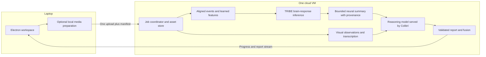

# TRIBE v2: local preprocessing and a shared inference VM

Inspected 5 October 2026. This is a source review and deployment design, not a
measurement of inference latency or a completed cloud integration. No model
weights or neuroscience datasets were downloaded or executed.

Sources inspected:

- [TRIBE source](https://github.com/facebookresearch/tribev2/tree/af58661791a351a448a489042a28f6c37e1c14b7),
  revision `af58661791a351a448a489042a28f6c37e1c14b7`.
- [Released checkpoint config](https://huggingface.co/facebook/tribev2/blob/f894e783020944dcd96e5568550afe2aa9743f9f/config.yaml),
  checkpoint repository revision `f894e783020944dcd96e5568550afe2aa9743f9f`.
- The Python source inside the upstream-pinned
  [neuralset 0.0.2 wheel](https://files.pythonhosted.org/packages/73/96/91557ba7821e01ece45c055c675a65c6c107706dcc4dcfff848050e4d4f1/neuralset-0.0.2-py3-none-any.whl),
  SHA256 `e1ba6e5709b86e8851591f1fd259c88d7b6ca14f960bcd5a69ff03cdeacdb265`.
  Downloaded with `pip download --no-deps`, extracted for reading, not installed.
  Its advertised GitHub source was unavailable during this review.

## Finding: local media preparation is possible

There are three separate stages. “Preprocessing” can mean either inexpensive
media operations or expensive learned feature extraction; these need different
placements.

| Stage | Source behavior | AdLens placement recommendation |
| --- | --- | --- |
| Event preparation | Video/audio events, audio extraction, chunks, aligned words and language context | Metadata and media operations may run locally; ASR/alignment stays on VM by default |
| Feature extraction | Video, acoustic and language encoders produce aligned hidden features | VM by default |
| Brain-response inference | Transformer maps feature tensors to predicted cortical responses | VM |

The public `get_events_dataframe()` pipeline extracts audio, builds events and
runs transcription. `predict(events)` accepts an already prepared event table,
so we can bypass that first pipeline with equivalent client-prepared events.
However, `predict()` calls `data.get_loaders()`, which prepares the learned
extractors before running the brain model. Sending a prepared event table does
not remove feature-extractor inference from the VM.
[Inference wrapper](https://github.com/facebookresearch/tribev2/blob/af58661791a351a448a489042a28f6c37e1c14b7/tribev2/demo_utils.py),
[data pipeline](https://github.com/facebookresearch/tribev2/blob/af58661791a351a448a489042a28f6c37e1c14b7/tribev2/main.py).

A VM running only the final brain model is also technically possible: reconstruct
its `SegmentData` inputs from precomputed, correctly aligned feature tensors.
The model consumes modality arrays shaped as batch × layers × feature channels ×
time. This requires a new validated tensor transport and equivalence tests; the
upstream public wrapper is not a ready-made remote tensor API.
[Model implementation](https://github.com/facebookresearch/tribev2/blob/af58661791a351a448a489042a28f6c37e1c14b7/tribev2/model.py).

Putting all learned feature extraction on an arbitrary laptop would undermine
our lightweight-client goal. Optional client preprocessing should therefore cover
file inspection, decoding, audio extraction, and packaging, with a remote fallback.

## Exact temporal input matters

The released configuration uses V-JEPA 2 (`facebook/vjepa2-vitg-fpc64-256`),
Wav2Vec-BERT 2.0, and Llama 3.2 3B as video, audio, and text feature extractors.
Features are aligned at 2 Hz. The video lookback is four seconds. The brain output
frequency is 1 Hz; configured inference segments span 100 output timesteps, and
the transformer is non-causal. Intermediate layer selection/aggregation is part
of the input contract. Colibrì's reasoning model cannot simply replace that text
feature encoder without changing the brain model's learned inputs.
[Checkpoint configuration](https://huggingface.co/facebook/tribev2/blob/f894e783020944dcd96e5568550afe2aa9743f9f/config.yaml).

In neuralset 0.0.2, `extractors/video.py` defaults V-JEPA 2 to 64 frames per clip,
constructs trailing windows at feature sample times, and clamps early frame times
to the beginning. It then invokes the model processor and encoder. Audio code
resamples to the extractor's expected rate, mixes channels, and normalizes audio.
This behavior must be reproduced, including timestamps, boundary handling,
processor versions, and event offsets, before moving those operations locally.
[Inspected dependency artifact](https://files.pythonhosted.org/packages/73/96/91557ba7821e01ece45c055c675a65c6c107706dcc4dcfff848050e4d4f1/neuralset-0.0.2-py3-none-any.whl).

Consequences for AdLens:

- The media-summary request's `max_frames: 12` is for semantic marketing analysis.
  It must not become TRIBE's video sampler.
- Preserve motion and synchronized timing. Do not reduce an entire Reel to a few
  independent thumbnails or treat 2 Hz features as two source frames per second.
- Extracted raw frames can be much larger than a compressed clip. Deduplicate
  overlapping samples, compress transport, and measure total upload + preprocessing
  + inference time before assuming a local frame path is faster.
- Independently chopping a video changes the context available to a non-causal
  model. Any streaming/windowing adaptation needs explicit boundary tests and a
  comparison with upstream predictions. Streaming report text is a separate issue.

The included transcription helper calls WhisperX `large-v3` with word alignment;
English is the default. Local ASR is an optional optimization requiring a suitable
model and validation of alignment, not a cheap universal requirement. Supplied
copy and a plain transcript are not aligned Word events.
[Transcription transform](https://github.com/facebookresearch/tribev2/blob/af58661791a351a448a489042a28f6c37e1c14b7/tribev2/eventstransforms.py).

## What the brain result means

The public inference output is a time × cortical-vertex array for an average
subject, on the fsaverage5 surface (approximately 20,000 vertices). Upstream
records a five-second hemodynamic alignment offset. Preserve its time convention
rather than blindly shifting it twice. This is model-predicted fMRI-like activity;
no viewer is being monitored. The five seconds describe physiological alignment,
not a promise about request latency.
[Upstream explanation](https://github.com/facebookresearch/tribev2/tree/af58661791a351a448a489042a28f6c37e1c14b7#quick-start).

Source inspection did not identify a marketing-engagement output head. Activity
magnitude, a regional peak, or a mean over the cortex is not by itself a validated
engagement score. For the deployed wrapper, keep the full array on the VM and
produce bounded summaries with explicit units, regions/atlas, time convention,
checkpoint/config identifiers, and the summarization method. Any engagement
mapping needs its own stated hypothesis and empirical evaluation.

The current client accepts an unscored response summary (`score: null`) so a real
TRIBE result can inform reasoning before a numerical proxy is justified. The
current response schema carries interpretation and method text, not the full
vertex matrix or a structured neural timeline. A richer regional/time-series
contract remains work for the real server integration. The reasoning prompt
forbids deriving scene timings from an untimed scalar or treating predictions as
observed viewer attention.

## Shared VM design

Proposed deployment, not yet implemented:

Use an asset ID after the first upload. The coordinator shares local media and
cached features and passes the neural result to Colibrì over loopback or in
process; raw tensors stay on the VM. Report progress comes from actual job events.
Separate provider interfaces remain useful even on one physical host.

This architecture removes redundant uploads and the TRIBE → laptop → reasoning
handoff. It does not establish a latency figure. Shared GPU/RAM/CPU/NVMe contention
may offset network savings. Benchmark warm and cold runs, model switching, memory
peaks, and concurrent jobs before choosing the VM configuration. The upstream
pipeline already attempts to release cached extractor models between stages;
this is not a blanket guarantee that all models fit concurrently.

The current Electron engine still uploads to the media and neural endpoints
separately and sends the neural result back in the reasoning request. Co-locating
those endpoints alone does not change that orchestration. A coordinator endpoint,
asset handles, and server-owned progress/cancellation are the next deployment work.

## Implemented in this update

- Validated TRIBE context now reaches the configured reasoning provider, with
  explicit available/unavailable/disabled status and the direct fusion weight.
- Successful model reports record whether neural context was supplied. Zero direct
  weight removes arithmetic blending, but not possible influence on interpretation.
- Unscored neural summaries are valid and never contribute a fabricated number.
- Video upload context separates copy and untimed transcript from sensory events.
  A wrapper may derive a text modality from speech in the original video.
- Focused tests cover the actual HTTP reasoning payload, failures, absent signals,
  unscored summaries, and numeric fusion behavior.

Local video preprocessing, a cloud coordinator, TRIBE execution, a calibrated
engagement mapping, and actual model latency remain unimplemented/unmeasured.
The upstream repository and dependency declare CC-BY-NC-4.0; retain this concrete
constraint when choosing how the research prototype will be used.
